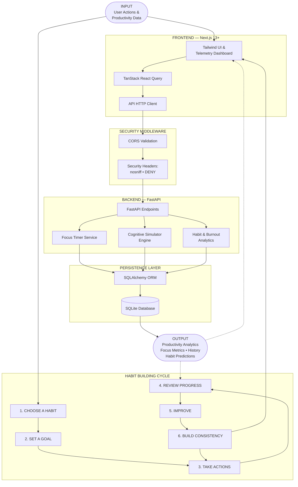

<p align="center">

</p>

# ◈ LIFE_CORE // Neural Life Command OS


## ◆ About the Project

LIFE_CORE is a personal productivity, habit tracking, and cognitive telemetry platform built with Next.js and FastAPI. It integrates focus timing protocols, session logging, predictive what-if simulators, and performance analytics into a single low-latency command center interface.

## ❖ Key Features

- Real-time productivity and focus output dashboard with animated telemetry gauges.
- Interactive focus timer supporting Pomodoro (25m), Deep Work (50m), and Rest intervals with distraction logging.
- Session activity journal with category filtering, duration tracking, and energy cost ratings.
- Predictive simulation module calculating burnout risk and habit velocity based on customizable user parameters.
- Hardened FastAPI backend featuring strict CORS validation, security header middleware, and parameterized SQLite storage.

## ◆ System Architecture




## ⬢ Technologies Used

- Next.js 13+ (App Router)
- React & TypeScript
- Tailwind CSS
- Python 3.10+
- FastAPI & Pydantic v2
- SQLAlchemy & SQLite

## § Requirements

- Node.js 18 or higher
- Python 3.10 or higher

## ▲ Installation & Execution

```
# 1. Start Frontend
npm install
npm run dev

# 2. Start Backend
cd backend
pip install -r requirements.txt
python -m uvicorn main:app --reload --port 8001
```

## ※ Developer

**Developer:** ISBANDU RAHUMAN R

**GitHub:** [https://github.com/ISBANDURAHUMAN-R](https://github.com/ISBANDURAHUMAN-R)

Add a quick-start workflowExplain the development server setup
